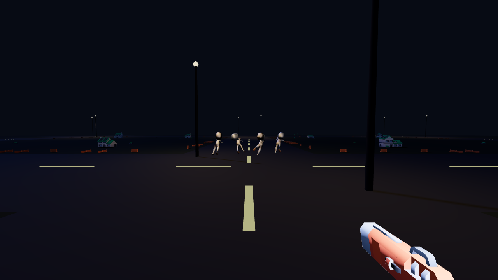
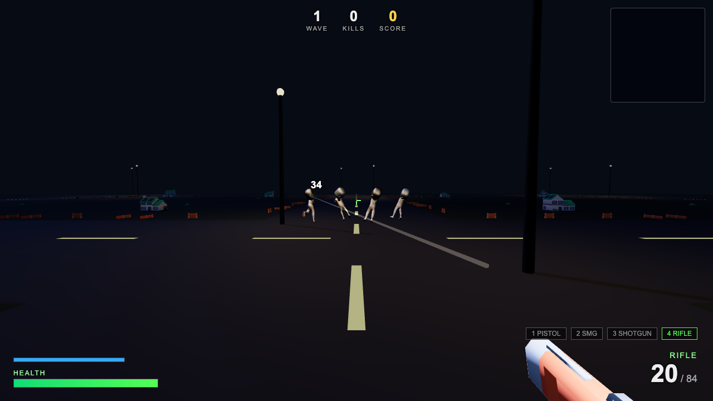
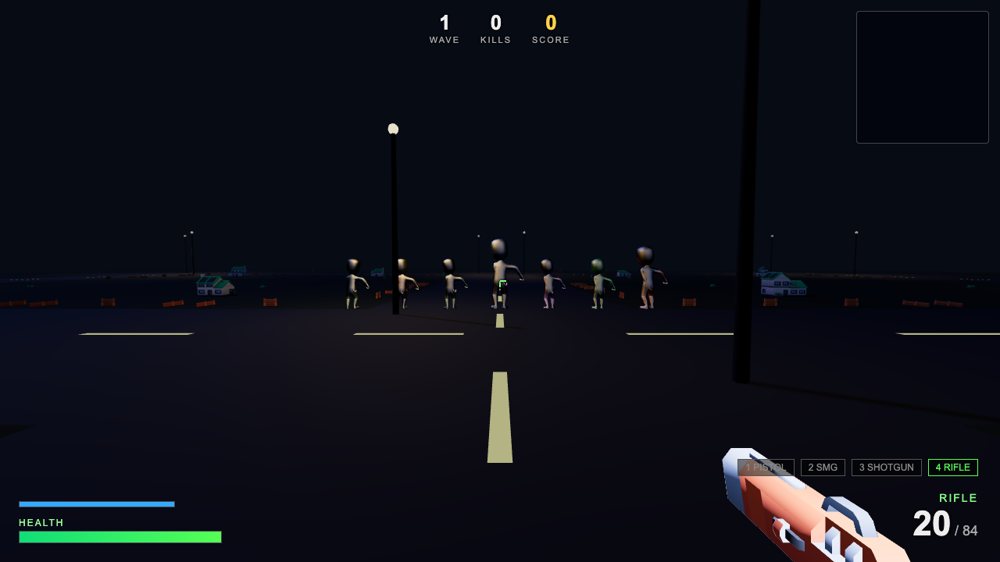
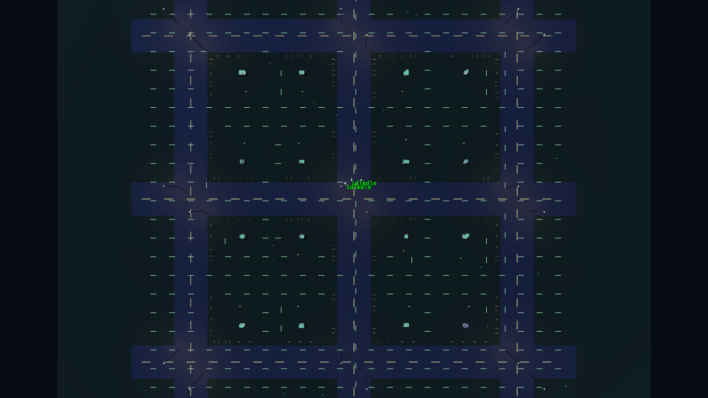
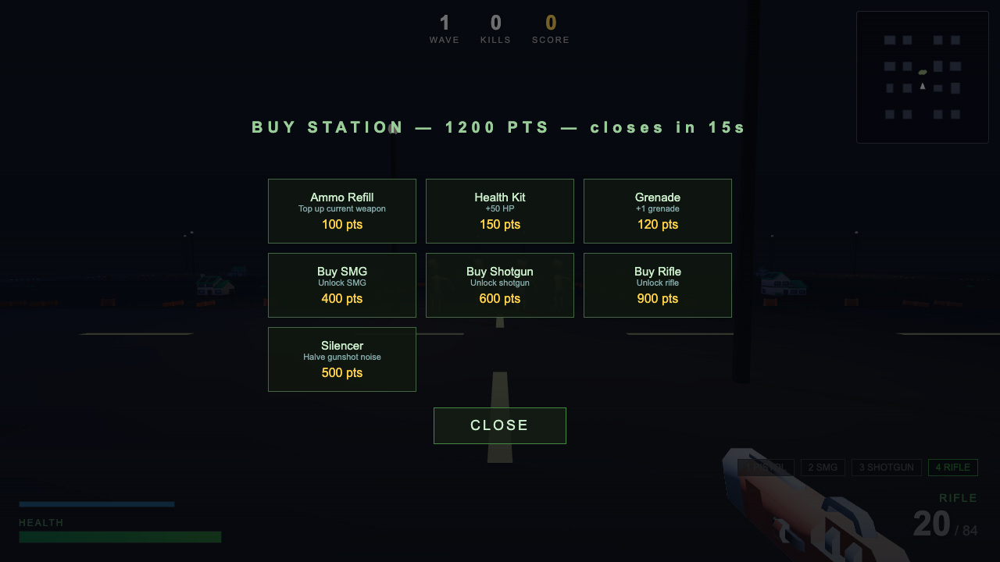

# 🧟 DEAD SUBURBIA

An advanced first-person zombie survival shooter that runs entirely in the browser.
Three.js r170 (ES-module import map from jsDelivr, **no build step**), Kenney CC0 art,
procedurally animated zombies, a Left 4 Dead-style AI director, and a synthesized Web Audio soundtrack.



## Run it

```bash
python3 -m http.server 8095
# open http://localhost:8095
```

Tests (pure logic, no browser):

```bash
node --test tests/
```

## Controls

| Key | Action |
|---|---|
| WASD | Move |
| Shift | Sprint (stamina) |
| Space | Jump |
| C | Crouch |
| Mouse | Look / Shoot |
| RMB | Aim down sights (rifle has a scope) |
| R | Reload (tactical reload keeps a chambered round) |
| 1–4 / wheel | Switch weapon (pistol, SMG, shotgun, rifle) |
| G | Grenade (arc preview, bounces, 2 s fuse) |
| V | Melee shove (pushes a crowd back) |
| F | Flashlight |
| M | Mute |
| Esc | Pause (sensitivity + volume) |

## Zombie types

| Type | Behaviour |
|---|---|
| **Walker** | Shambles at you, arms raised, limps on a random leg |
| **Runner** | Wave 3+, fast, zig-zags when you aim at it |
| **Crawler** | Spawns on low waves; any zombie whose legs take enough damage becomes one |
| **Brute** | 1.4× size, armoured front (shoot the head or back), charges in a straight line and knocks you back |
| **Screamer** | Screams on sight and alerts every zombie within 40 m — kill it first |
| **Spitter** | Keeps distance, strafes, lobs green goo that leaves a damaging puddle |
| **Bloater** | Slow; explodes when killed or on contact — it hurts zombies too |

Each zombie is individually animated: an FBX run clip played at shamble speed plus a
procedural bone layer (hunch, raised arms, limp, sway, lunge-swipe attacks, direction-aware
hit flinches, knockdown/get-up, crawl, and a spring-bounce death fall in the shot direction).
Hit detection uses sphere hitboxes parented to the head/chest/hips/leg bones, so headshots,
leg shots and body shots all behave differently.

The AI runs a per-zombie state machine (idle → wander → investigate → alert → chase/flank →
attack → stagger/knockdown/crawl → dead) on top of a flow-field navigation grid rebuilt
every 0.5 s, with vision cones blocked by houses, gunshot hearing, last-known-position
memory, surround-slot claiming, group attack tokens and fence bashing. An AI director tracks
your health, ammo and kill speed, runs build-up/peak/relax cycles, sends specials when you
camp, drops supplies when you're low, and unleashes a horde every 5th wave.

## URL debug params

- `?demo=1` — skip menus, player on a street facing zombies
- `&view=street|zombies|weapon|map|ads|fire`
- `&anim=walk|attack|hit|crawl|death` — freeze a zombie group mid-animation
- `&types=1` — line up every zombie type
- `&debug=ai` — state labels over zombies + flow-field arrows in `&view=map`
- `&wave=1` / `&buy=1` / `&z50=1` — wave, buy station, 50-zombie stress test

## Screenshots

| | |
|---|---|
|  | Mid-shot: muzzle, tracer, goo, damage numbers |
|  | All seven zombie types |
|  | Flow-field arrows + AI states (`&view=map&debug=ai`) |
|  | Between-wave buy station |

## Credits

- All 3D assets: [Kenney.nl](https://kenney.nl) (CC0) — City Kit: Suburban, Blaster Kit,
  Animated Characters: Survivors / Protagonists, Modular Cave Kit, Space Station Kit.
- Built by **Qwen** running on an **AMD Strix Halo** with **OpenCode**.
